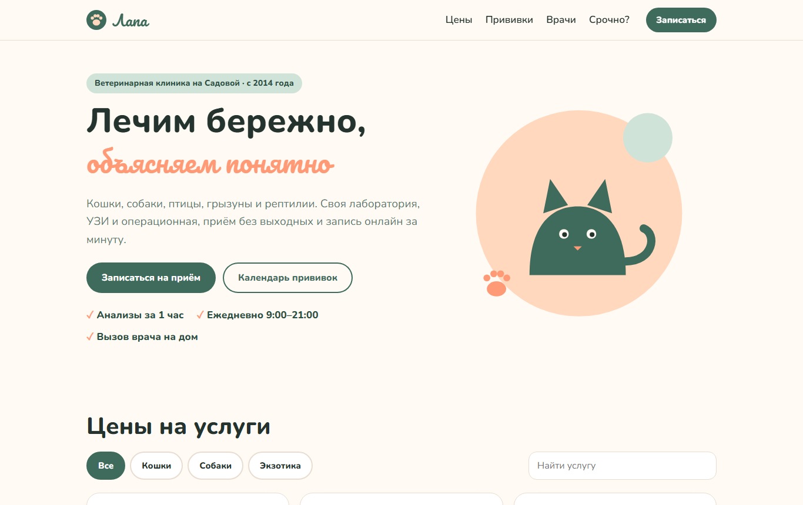

# Лапа: сайт ветеринарной клиники

Сайт ветклиники, который помогает хозяину питомца, а не только рассказывает об услугах. На нём есть прайс с фильтром по животному, календарь прививок для котёнка или щенка, запись к врачу на свободное время и памятка, когда к врачу нужно в тот же день. Без фреймворков: HTML, CSS и модульный JavaScript.


**Демо:** [whysafe.github.io/lapa-vet](https://whysafe.github.io/lapa-vet/)



## Возможности

- **Цены.** Услуги сгруппированы (приём, прививки, операции, анализы), есть фильтр «кошки / собаки / экзотика» и поиск по названию.
- **Календарь прививок.** По дате рождения котёнка или щенка строится типовой график: первая прививка в 8 недель, ревакцинация с бешенством в 12, у щенков третья в 16, дальше раз в год. Для каждой прививки указана дата обработки от глистов (за 10 дней) и статус: «скоро», «пора», «запланировано».
- **Запись.** Выбираете врача и видите его свободные часы на неделю: только рабочие дни, только будущее время. Форма проверяет имя, телефон и кличку питомца. Это демо, поэтому запись сохраняется в браузере.
- **«Когда к врачу нужно сегодня».** Короткий список опасных симптомов с телефоном клиники.
- **Оформление.** Шалфейно-зелёный и персиковый, шрифты Nunito и Pacifico, кот на первом экране нарисован в SVG. Адаптив от 360 px, видимый фокус для клавиатуры.

## Запуск

```bash
python -m http.server 8000     # затем http://localhost:8000
```

## Как устроено

```
js/logic.js   прайс, график прививок, свободные слоты, проверка формы, без DOM
js/app.js     работа со страницей
test/         node:test для logic.js
```

Занятые слоты в демо выбираются детерминированно (хеш от врача, даты и часа). Расписание выглядит живым, но у всех одинаковое и не меняется при перезагрузке.

## Тесты

```bash
npm test
```

8 тестов: фильтр и группировка прайса, даты и статусы графика прививок для котёнка и щенка, отказ на дату рождения в будущем, свободные слоты (рабочие дни, часы приёма, ничего в прошлом), детерминированность расписания и проверка формы записи.

## Автор

whysafe · [whysafe.ru](https://whysafe.ru) · Telegram [@yawhysafe](https://t.me/yawhysafe) · канал [@whysafe_official](https://t.me/whysafe_official) · [Kwork](https://kwork.ru/user/whysafe) · hello@whysafe.ru

## Лицензия

MIT
